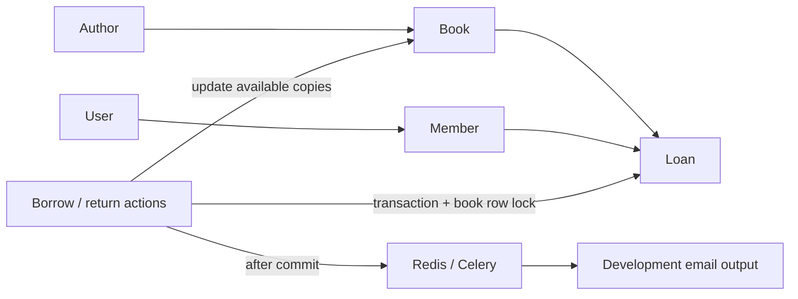

# Library lending API

A small Django REST application for authors, books, members and loans. Its main
workflow is borrowing an available copy, extending an eligible loan, then
returning it without counting that copy twice. PostgreSQL stores the records;
Celery handles loan notifications through Redis.

This is a backend example, not a hosted library-management product. The browsable
API is available at `/api/`, and Django admin at `/admin/`.

## How the records fit together



Borrowing creates a loan with a default due date 14 days away and subtracts one
available copy. Returning marks the oldest active loan for that member/book as
returned and restores one copy. A repeated return cannot restore it again.
Renewals accept a positive `additional_days` value; returned and overdue loans
cannot be renewed. A loan due today can still be renewed.

## Run with Docker Compose

Requirements: Docker with Compose, and free ports 8000, 5432 and 6379.

```sh
git clone https://github.com/dev-nezuko/django-book-lending-api.git
cd django-book-lending-api
cp .env.example .env
```

Replace the example signing key and database password in `.env` with local values.
To generate a signing key, use `python -c "import secrets; print(secrets.token_urlsafe(48))"`.
Keep the resulting value in `.env`; do not commit it.

```sh
docker compose up --build -d
docker compose exec web python manage.py createsuperuser
docker compose logs -f web celery
```

The web service waits for healthy PostgreSQL and Redis services, applies
migrations, then starts Django's development server. Use admin to create users
and their member records, plus authors and books, before trying the loan actions.
`POSTGRES_DB`, `POSTGRES_USER` and `POSTGRES_PASSWORD` configure both the database
container and Django. `DB_HOST=db` and `redis://redis:6379/0` refer to Compose
service names; use host-reachable addresses when running Python outside Compose.

## Try the lending workflow

These examples assume book `1` and member `1` exist. Use the loan ID returned by
the borrow response for the renewal request.

```sh
curl -X POST http://localhost:8000/api/books/1/loan/ \
  -H 'Content-Type: application/json' -d '{"member_id": 1}'

curl -X POST http://localhost:8000/api/loans/1/extended_due_date/ \
  -H 'Content-Type: application/json' -d '{"additional_days": 7}'

curl -X POST http://localhost:8000/api/books/1/return_book/ \
  -H 'Content-Type: application/json' -d '{"member_id": 1}'
```

A successful borrow returns `201` with a status message and the saved loan,
including its `id` and ISO-format `due_date`. An unavailable copy, missing/invalid
member, invalid extension or repeated return produces `400`; an unknown book or
loan produces `404`. Successful renewals and returns produce `200`.

| Resource | Operations |
| --- | --- |
| `/api/authors/` and `/api/authors/{id}/` | Author CRUD |
| `/api/books/` and `/api/books/{id}/` | Book CRUD |
| `/api/members/` and `/api/members/{id}/` | Member CRUD; `user_id` refers to an existing Django user |
| `/api/loans/` and `/api/loans/{id}/` | List and retrieve loans |
| `/api/books/{id}/loan/` | Borrow with `member_id` |
| `/api/books/{id}/return_book/` | Return with `member_id` |
| `/api/loans/{id}/extended_due_date/` | Extend with `additional_days` |

Lists use `count`, `next`, `previous` and `results`. The default page size is 10;
`?page=2&page_size=25` selects another page, with a maximum page size of 100.
Loan records are read-only outside the dedicated lending actions so direct loan
CRUD cannot bypass copy accounting.

## Notifications and overdue checks

New-loan notification tasks are queued **after** the database transaction commits.
A broker dispatch failure is logged; it does not turn an already-created loan
into an apparent failed request. There is no transactional outbox or automatic
reconciliation for a missed dispatch.

Email uses Django's console backend in development, so messages appear in worker
logs. The overdue task checks unreturned loans whose due date is before today
and skips members without an email address. To enqueue a check manually:

```sh
docker compose exec celery celery -A library_system call library.tasks.check_overdue_loans
```

No periodic Beat schedule is configured. Repeated overdue checks may send another
reminder for the same loan; reminder deduplication is not implemented.

## Tests without running services

For Python 3.11:

```sh
python3.11 -m venv .venv
source .venv/bin/activate
python -m pip install -r requirements.txt
python manage.py test --settings=library_system.test_settings
python manage.py makemigrations --check --dry-run --settings=library_system.test_settings
```

The test configuration uses an in-memory SQLite database, in-memory mail and
mocked task delivery. Regression cases cover borrowing/returning stock,
transaction rollback, due-date validation, pagination and notification/reminder
boundaries. These tests do not establish PostgreSQL locking behavior under
concurrent clients or verify live Redis/SMTP delivery.

## Scope and deployment limits

The supplied configuration allows anonymous API access, unrestricted CORS and
uses a development server. It has no member-level authorization model. Protect
the API, restrict CORS, configure production secrets/serving/email and validate
concurrent workloads before deploying it with real member data. No production
scale or delivery guarantee is claimed.

Implementation lives in `library/`; settings, URL registration and Celery setup
live in `library_system/`. See [CONTRIBUTING.md](CONTRIBUTING.md) for focused change
and test guidance.
